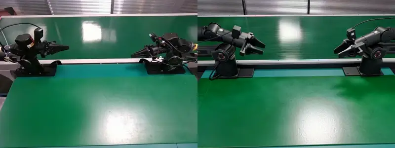

# 松灵 PiPER 双臂传送带分拣

<p align="center">
  <a href="https://github.com/Peaceful-World-X/PiPER-ExpSort"></a>
  
  
  
  
  
</p>

<p align="center">
  <a href="https://github.com/Peaceful-World-X/PiPER-ExpSort/blob/main/renders/PiPER-ExpSort.mp4"></a>
</p>

<p align="center">
  <a href="https://xhslink.cn/o/A1ITg5kKqO5">🎬 在线查看</a>
</p>

在 NVIDIA Isaac Sim 中复现松灵 PiPER 双臂分拣快递，40 件包裹随传送带从左侧入镜，右臂把选中的软袋夹到工作台，左臂接手并送入侧槽。场景采用运动学回放。37 个软袋分别拟合厚度与封边，10 次翻面按真机中的侧立时刻重建。

## 渲染方式

- **交互预览**使用 RTX 实时渲染。时间轴为 50 Hz，可按空格播放或暂停，拖动时间轴查看抓取、翻面和落台。
- **视频导出**使用 RTX 路径追踪。原速仿真为 960×720、50 fps、40 秒。

## 运行

在项目根目录打开 PowerShell。场景生成使用 64 位 Python 3.12，预览和渲染使用 Windows 版 Isaac Sim 自带的 Python。已有 `.venv` 和 `ConveyorCell.usdc` 时，可直接启动交互预览。

```powershell
# 首次安装并构建场景。本机使用 Conda 环境 py312
# 在其他已激活的 Python 3.12 环境中，可用 python -m venv .venv
conda run -n py312 python -m venv .venv
.\.venv\Scripts\python.exe -m pip install -r requirements.txt
.\.venv\Scripts\python.exe source\build_conveyor.py

# 指向本机含 python.bat 的 Isaac Sim 安装目录
$env:ISAAC_SIM_PATH = 'D:\APP\APP_code\Isaac-sim'

# 实时交互。追加 --overview 可切换到工位全景
.\LaunchSimulation.bat

# 完整导出。
.\RenderVideo.bat
```

## 素材

PiPER 模型来自 MuJoCo Menagerie，网格与运动学描述随项目保存在 `assets/agilex_piper/`。[模型许可](assets/agilex_piper/LICENSE)

包裹厚度按真机单机位轮廓估计，逐件参数见 [袋体轮廓数据](assets/pouch_profiles.txt)。入带朝向、落台朝向和翻面时刻见 [翻面观测](assets/turnovers.txt)。
